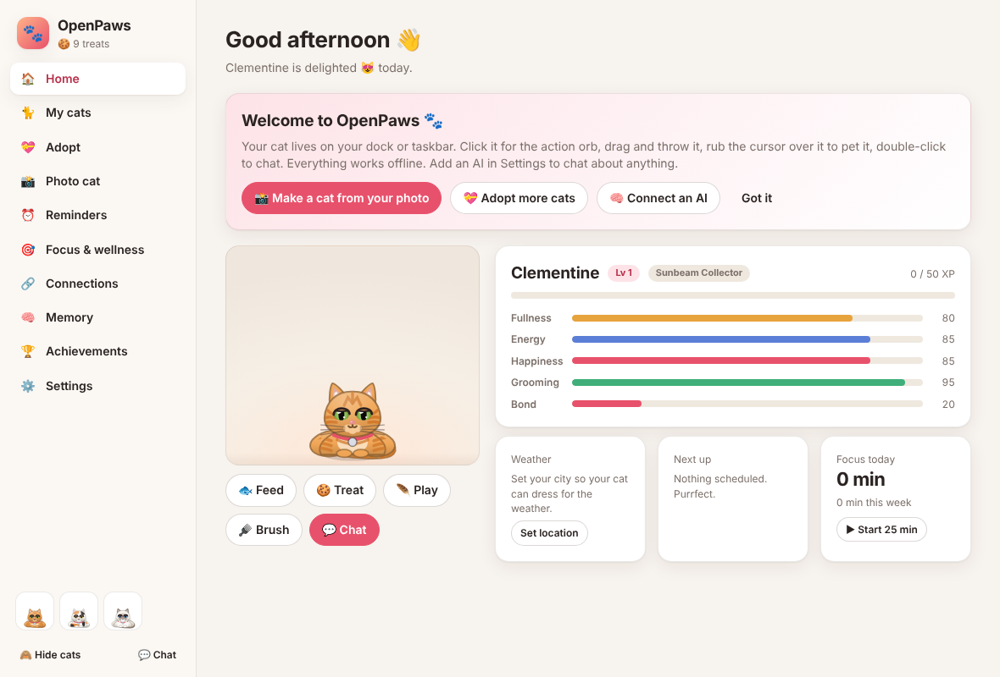
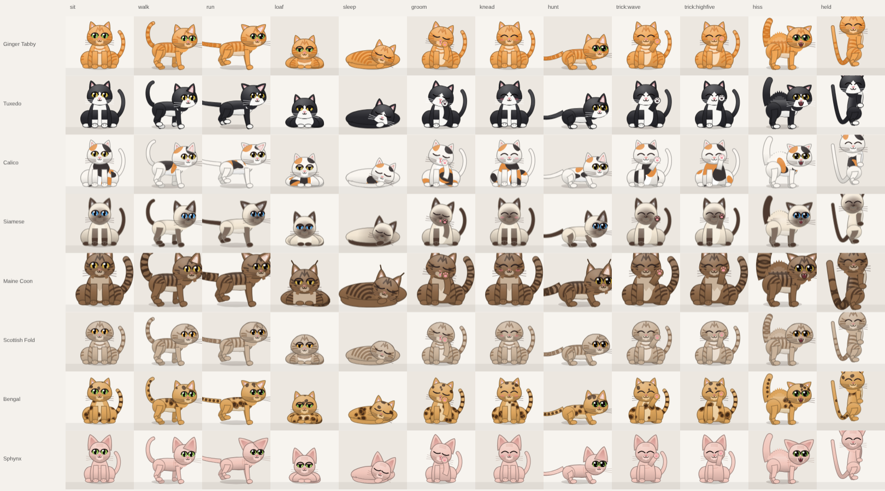

# 🐾 OpenPaws

An open-source AI desktop cat for **macOS, Windows and Linux**.

- Your cat lives on your dock or taskbar. It walks, climbs the edges of the screen, naps, grooms, kneads and chases your cursor.
- It chats with you and remembers what matters to you.
- It keeps you on track with reminders, focus sessions, weather and calendar heads-ups.
- Adopt one of 18 original cats, or **turn photos of your own cat into a photo-real desktop cat with on-device AI**: no account, no cloud, no fees.





## Quick start

```bash
cd openpaws
npm install
npm start
```

A cat moves onto your screen and the Control Center opens.
- **Click** the cat for the action orb.
- **Drag** it to pick it up, and **flick** to throw it.
- **Rub** the cursor back and forth over it to pet it.
- **Double-click** it to chat.
- **Right-click** it for everything else.

### Installers

**Build on your own machine:**

| Command | Run on | Output in `dist/` |
|---|---|---|
| `npm run dist:mac` | a Mac | Universal DMG |
| `npm run dist:win` | Windows | Installer and portable `.exe` |
| `npm run dist:linux` | Linux | AppImage and `.deb` |

**Download from CI:** the **OpenPaws** GitHub Actions workflow builds all three on every change under `openpaws/`. Download them from the run's *Artifacts*.

**Unsigned builds:**
- macOS: right-click the app and choose **Open** the first time.
- Windows: SmartScreen → **More info** → **Run anyway**.

## Features

### Your cat on your screen
- **Physics:** walks on the dock or taskbar. Gravity, dragging with a pendulum dangle, and throwing with real momentum. Cats land on their feet (and sometimes hiss about it).
- **Climbing and roaming:** climbs screen edges, walks along the ceiling, and strolls across multiple monitors. Occasionally wanders off screen and comes back with a story.
- **Real cat behaviour:**
  - Loafing, kneading ("making biscuits"), grooming, stretching, yawning and slow-blinking at you.
  - Scratching the edge of the screen.
  - Zoomies.
  - The hunting crouch with a butt-wiggle before the pounce.
- **Play:**
  - Throw a ball and it fetches.
  - Dangle a feather wand (a physics rope that follows your cursor), or use the laser pointer.
  - Drop food or a treat.
- **Several cats:** they greet each other and play chase.
- **Weather reactions:** an umbrella in the rain, plus rain and snow falling across the screen.
- **Gesture orb:** click the cat for a ring of actions (chat, feed, treat, fetch, wand, tricks, remind me, nap, walk).
- **Speech bubbles:** text types out with cat babble or real text-to-speech. Reminder bubbles have **Done** and **Snooze** buttons.
- **Low footprint:**
  - Click-through everywhere except the cat itself, and photo cats are pixel-accurate.
  - About 12 fps while everyone naps.

### Cats
- **18 adoptable cats with original personalities:** name, nickname, breed, age, gender and story.
- **19 coats and breeds:** tabby (classic "M"), tuxedo, calico, tortoiseshell, Siamese and Ragdoll points, Maine Coon ear tufts, Scottish Fold ears, Persian, Bengal rosettes, Sphynx and more.
- **Two views, like a real cat:** resting cats face you, and moving cats turn side-on. Eyes have slit pupils that dilate when excited, plus blinks, slow-blinks and whiskers.
- **Accessories:** hats, bows, flowers, collars and bells, bandanas, scarves, bow ties, glasses, all recolourable.
- **Needs:** fullness, energy, happiness, grooming and bond. Needs decay gently, and much more slowly while you're away.
- **Progression:** XP and levels, **12 trainable tricks** (sit, wave, slow blink, make biscuits, beg, spin, zoomies, roll over, high five, dance, play dead, backflip), and 21 achievements.
- **Treats:** earned by finishing reminders and focus sessions, and spent on your cat.
- **Adoption certificate:** download it as a PNG.

### Photo cats (the Furever Dock-style experience, done locally)
- **On-device AI cutout:** U²-Net (fast, 4.6 MB) or IS-Net (best, 179 MB). Downloaded once, SHA-256 verified, and run with ONNX Runtime. Your photos never leave your computer.
- **Edge cleanup:** soft edges, stray-blob removal and fur-edge colour decontamination. **Tap the cutout** to choose the right animal.
- **Pose slots:** standing, sitting, lying, sleeping, walking, playful and begging. Each behaviour uses the matching real photo.
- **Video → animation:** a few seconds of your cat walking, playing or sleeping becomes a frame-by-frame photo-real animation.
- **Living-photo rig:** even one still breathes, tilts and turns its head toward your cursor, wags its tail and shuffles its legs when it walks, using automatic rigging and a mesh warp.
- **Cartoon look-alike:** reads your cat's fur colours from the photo.
- **Shimeji import:** brings in a Shimeji sprite pack, if you have the rights to its art.

### Brain
- **Works offline out of the box:** reminders, timers, focus, to-dos, weather, calendar, tricks, jokes, and remembering facts you tell it.
- **Optional AI providers:**
  - **Claude** (default `claude-opus-5-5`, low effort, with server-side refusal fallbacks).
  - **OpenAI** and **Google Gemini**.
  - **Ollama** or **LM Studio** locally.
  - Any OpenAI-compatible server (OpenRouter, Groq, Mistral…).
- **18 tools:** weather, reminders (create, list, complete, cancel, snooze), timers, focus, to-dos, calendar, inbox search (read-only), memory, status, and doing cat moves on screen.
- **Replies move the cat:** each reply starts with an emotion tag, so the cat reacts while it talks.
- **Memory:** long-term memory you can see, edit and delete, plus an "about you" summary.
- **Voice:** cat babble or system text-to-speech per cat. Push-to-talk speech-to-text through any OpenAI-compatible Whisper server, local ones included.

### Productivity and wellness
- **Natural-language reminders:** "remind me to call mum tomorrow at 6pm", "standup every weekday at 9:30", "drink water every 45 minutes". Plus snooze, a nudge if ignored, catch-up after the app was closed, and a to-do list.
- **Focus sessions:** short and long breaks. Your cat sits with a tiny laptop while you work, and you get a 7-day chart.
- **Habit nudges:** water, stretch and 20-20-20 eye breaks, counted in active time only.
- **Quiet:** quiet hours and do-not-disturb.
- **Awareness of you:**
  - Your cat falls asleep when you step away or lock the screen, and welcomes you back.
  - A morning hello with the weather and your agenda.
  - A late-night bedtime nudge.

### Connections (all optional, all read-only)
- **Weather** from Open-Meteo (no key needed). Search your city, or detect it.
- **Calendars:** any iCal link (Google Calendar, Outlook, iCloud, Teams) plus your Microsoft 365 calendar. Heads-up a few minutes before each event, with a Join/Open button.
- **Microsoft 365 / Outlook:** device-code sign-in with your own free app registration.
- **Gmail:** desktop OAuth with PKCE.

With Outlook or Gmail connected, your cat scans recent mail (subject, sender and preview only) and *suggests* reminders and memories, such as interviews, bills, deliveries and appointments. Nothing is saved until you accept it.

## Privacy
- Everything is stored locally in your OS user-data folder.
- API keys and sign-in tokens are encrypted with your OS keychain (Electron `safeStorage`) and excluded from backups.
- Network calls go only to the services you turn on, through Chromium's network stack, so corporate proxies and PAC files work.
- No telemetry.

## Architecture

```
src/main/            Electron main process
  main.js            boot, hooks (the cat speaks for reminders, events, focus...), tray, shortcuts
  windows.js         one transparent click-through overlay per display, Control Center, chat
  ipc.js             every action the UI can take; native right-click menu; gesture orb actions
  pets.js            needs, XP and levels, training, treats, achievements
  store.js / secrets.js / assets.js   JSON store, encrypted secrets, paws-asset:// protocol
  brain/             providers (Anthropic SDK, OpenAI-compatible), 18 tools, offline brain, memory, prompts
  services/          reminders (+ chrono-node), scheduler, weather, wellness/focus, calendar (node-ical),
                     Microsoft Graph, Gmail, inbox suggestions, on-device cutout (ONNX Runtime), speech-to-text
src/renderer/
  shared/engine.js   physics + behaviour state machine (pure JS, unit-tested in Node)
  shared/draw.js     the vector cat renderer (front and side views, coats, accessories)
  shared/sprites.js  photo cats: pose photos, video frames, living-photo mesh warp, alpha hit-test
  shared/photo.js    mask refinement, autorig, sticker outline, colour extraction
  shared/effects.js  hearts, zzz, confetti, rain and snow, food, ball, feather wand, laser
  overlay/           the desktop layer
  panel/             Control Center + photo cat creator
  chat/              chat window with push-to-talk
```

## Development
- `npm test`: 39 unit tests (engine, reminders, brain and tool loops with mocked Claude/OpenAI APIs, calendar, inbox heuristics, cutout).
- `npm run smoke -- --smoke-out=shots`: boots the real app, screenshots every window and runs a chat. Add `--smoke-tabs` for every Control Center tab, or `--smoke-photo=cat.jpg` to run the photo-cat pipeline end to end.
- `scripts/gallery.html`: every coat in every pose, for reviewing the art.
- `scripts/icons.html`: regenerates the icons in `build/`.

See [docs/BENCHMARK.md](docs/BENCHMARK.md) for the comparison with Furever Dock and 18 open-source desktop-pet projects, and [NOTICE.md](NOTICE.md) for credits and licences.

## Licence

MIT. OpenPaws is an independent project and is not affiliated with Furever Dock.
